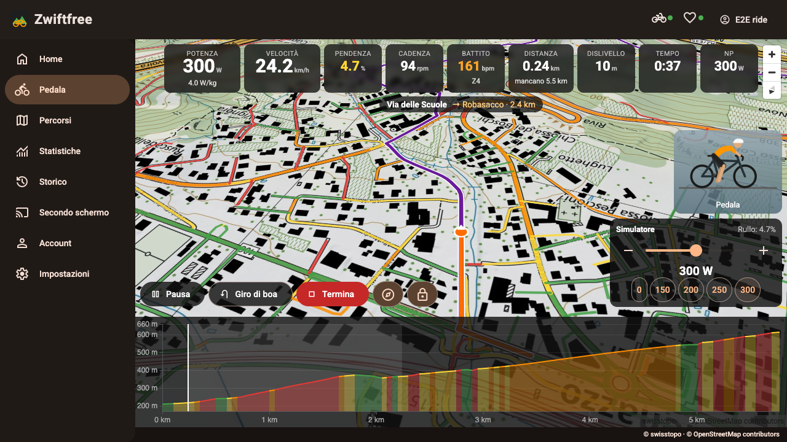
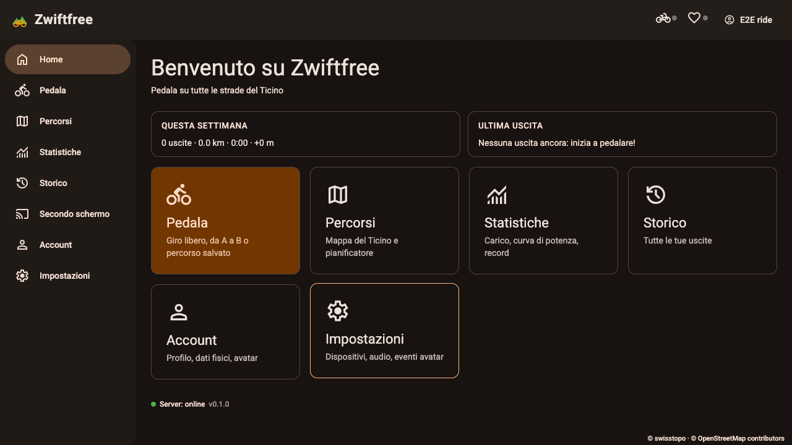
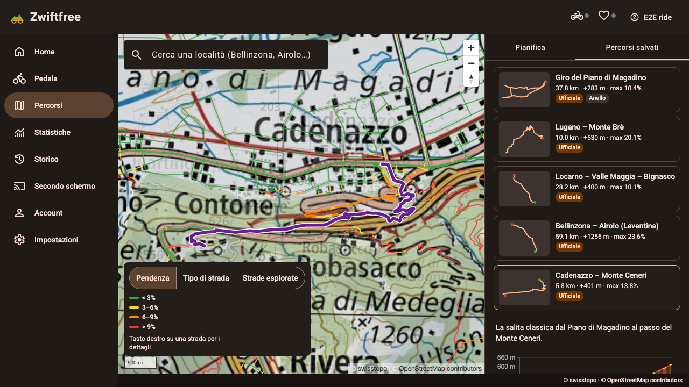
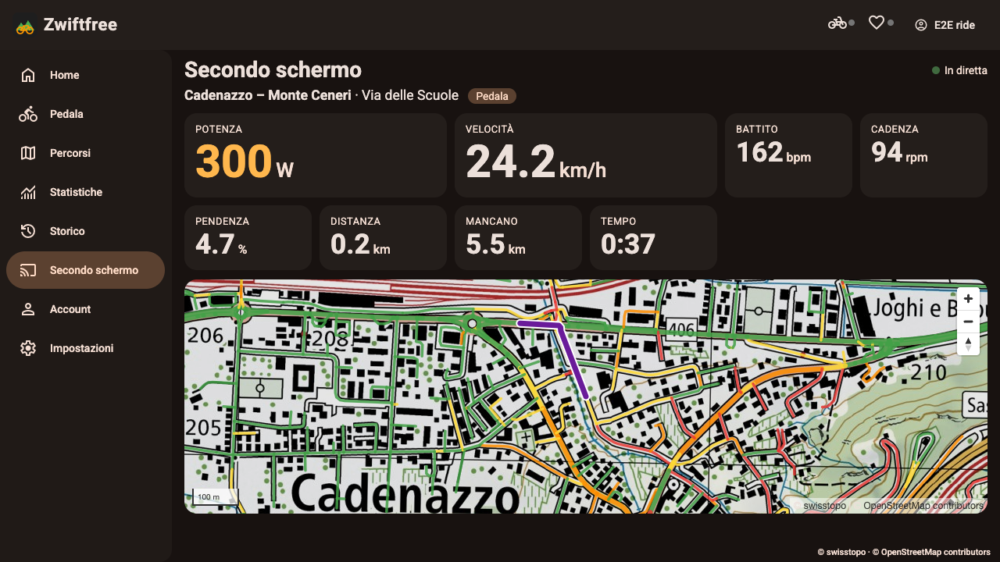
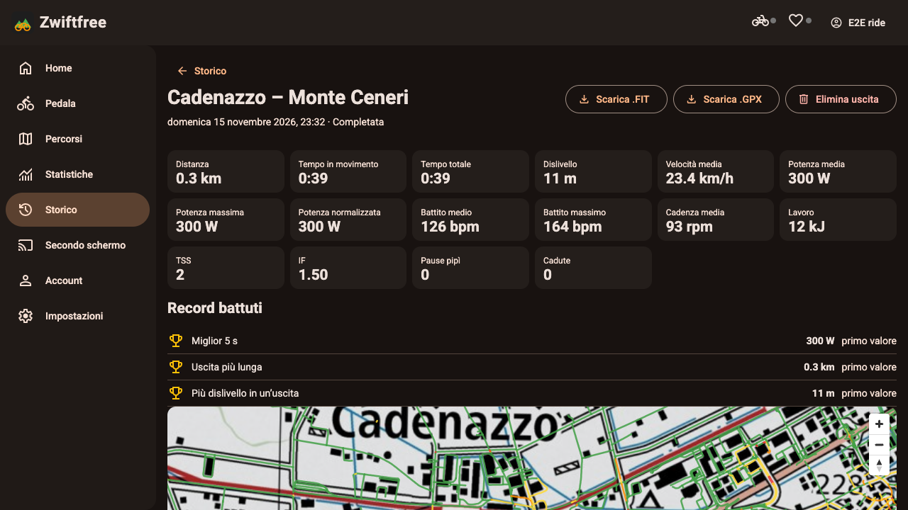
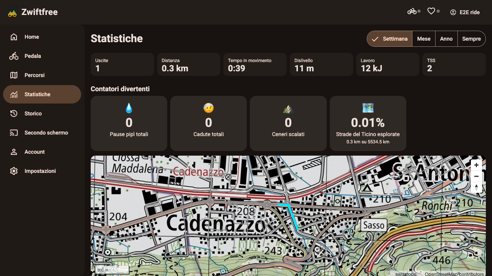

# Zwiftfree

Ciclismo indoor su **tutte le strade reali del Canton Ticino**: rullo smart via Web Bluetooth, mappa swisstopo,
giro libero con scelta agli incroci, pianificatore da A a B, statistiche e un avatar con qualche sorpresa.

> Stato: **completo (milestone 8 di 8)**. Rullo FTMS/FE-C e fascia cardio via Web Bluetooth (o simulatore), mappa
> live con HUD, percorsi ufficiali e pianificatore, giro libero con svolte agli incroci, avatar con pausa pipì e
> cadute, statistiche (carico, curva di potenza, record, segmenti), export **.FIT / .GPX** e **secondo schermo**
> in diretta su telefono o tablet. Vedi [docs/ARCHITECTURE.md](docs/ARCHITECTURE.md),
> [docs/API.md](docs/API.md) e [docs/DECISIONS.md](docs/DECISIONS.md).



## Requisiti

- Docker con Compose v2 (Docker Desktop o OrbStack)
- Per lo sviluppo: JDK 25+, Node.js ≥ 24.15 (consigliato 26 LTS)
- Per i test end-to-end: Chrome installato oppure `npx playwright install chromium`

## Browser supportati

| Browser | Rullo e cardio (Web Bluetooth) | Simulatore, mappe, statistiche, secondo schermo |
| --- | --- | --- |
| Chrome / Edge desktop (Windows, macOS, Linux) | ✓ | ✓ |
| Chrome Android | ✓ | ✓ |
| Safari (macOS, iOS), Firefox, tutti i browser su iOS | — | ✓ |

Web Bluetooth funziona solo su HTTPS oppure `localhost`: per collegare il rullo da un altro dispositivo della rete
serve HTTPS davanti al frontend. Il secondo schermo invece funziona anche in HTTP sulla rete di casa
(`http://<ip-del-computer>:4280/live`).

## Avvio con Docker

```bash
cp .env.example .env        # poi cambia DB_PASSWORD e JWT_SECRET (openssl rand -base64 48)
docker compose up -d --build
```

- App: http://localhost:4280
- API / Swagger UI: http://localhost:8090/swagger-ui
- PostgreSQL: `localhost:5442` (immagine `db/Dockerfile`: PostgreSQL 17 + PostGIS + pgRouting, nativa anche su
  Apple Silicon)

## Avvio in sviluppo

```bash
docker compose up -d db
cd backend/Zwiftfree-be && DB_PASSWORD=... JWT_SECRET=... ./mvnw spring-boot:run   # http://localhost:8090
cd frontend/zwiftfree-fe && npm install && npm start   # http://localhost:4200 (proxy /api → 8090)
```

Test e qualità:

```bash
cd backend/Zwiftfree-be && ./mvnw verify        # JUnit 5 + Testcontainers (serve Docker) + Spotless
cd frontend/zwiftfree-fe && npm test && npm run lint && npm run format:check
```

Test end-to-end (Playwright) contro lo stack Docker avviato (`docker compose up -d`): registrazione e login,
pedalata in simulatore su un percorso ufficiale con il secondo schermo aperto in un'altra scheda, riepilogo,
export .FIT/.GPX, storico e statistiche, giro libero con le frecce agli incroci. Gli account di prova vengono
cancellati alla fine.

```bash
cd frontend/zwiftfree-fe
npx playwright install chromium     # una volta (oppure PW_CHANNEL=chrome per usare Chrome installato)
npm run e2e                         # E2E_BASE_URL=http://localhost:4200 per lo stack di sviluppo
SCREENSHOTS=1 npm run e2e           # rigenera anche gli screenshot in docs/screenshots
```

## Come si pedala

1. **Pedala** → scegli un percorso salvato oppure cerca una località per il giro libero (oppure, dalla pagina
   *Percorsi*, "Pedala questo percorso" / "Giro libero da qui").
2. **Collega rullo** e **Collega fascia cardio** aprono il selettore Bluetooth del browser (Chrome/Edge). Rulli
   supportati: FTMS (Tacx, Wahoo, Elite recenti); per i Tacx più vecchi si usa FE-C. Senza rullo collegato si
   pedala con il **simulatore**. I dispositivi restano collegati tra un'uscita e l'altra; in *Impostazioni* puoi
   dimenticarli.
3. Controlla peso e FTP e premi **Parti**.
4. Con il rullo la pendenza del percorso viene inviata al rullo (scalata dalla "difficoltà" nelle impostazioni,
   discese al massimo −5 %). Con il simulatore imposti la potenza con lo slider o con **↑ / ↓** (±10 W).
   **← → ↑** scelgono la svolta quando compaiono le frecce prima di un incrocio (↑ = dritto), **spazio** mette in
   pausa.
5. **Giro di boa** fa un'inversione a U: su un percorso torni alla partenza sulle stesse strade.
6. **Pausa pipì e cadute** (disattivabili in *Impostazioni*): fermo per 20 s (configurabile) l'avatar va dietro un
   cespuglio, si riparte pedalando. Frenate brusche in discesa veloce o curve strette prese sopra i 45 km/h possono
   far cadere l'avatar: resta a terra qualche secondo, poi pedala per rialzarti. Con "assistenza in curva" la bici
   rallenta da sola prima delle curve strette.
7. **Termina** (due clic) salva l'uscita e apre il riepilogo; le uscite sotto i 10 secondi non vengono salvate.

8. Nel **riepilogo**: grafici, zone di potenza e cardio, record battuti, tempi sui segmenti, e i pulsanti
   **Scarica .FIT** / **Scarica .GPX** per Garmin Connect, Strava, intervals.icu & co. (attività "virtual ride",
   con potenza, cadenza, battito e quota).

**Secondo schermo**: apri *Secondo schermo* (`/live`) su telefono o tablet, con lo stesso account. Mentre pedali
sull'altro dispositivo mostra in diretta potenza, velocità, battito, cadenza, pendenza, distanza, tempo e la
posizione sulla mappa (WebSocket, un aggiornamento al secondo), e tiene lo schermo acceso.

I campioni vengono inviati ogni 30 secondi; senza connessione restano nel browser (IndexedDB) e partono appena la
rete torna, anche alla riapertura dell'app. Le uscite rimaste "non concluse" (finestra chiusa) si chiudono dallo
storico con *Concludi e salva*.

## Dati della rete stradale

`data/scarica_ticino.py` genera in `data/out/` la rete del Ticino (OpenStreetMap + quote swissALTI3D).
La cartella `data/out/` non è nel repository: rigenerala con lo script (20–60 minuti, qualche GB di download).

All'avvio il backend importa `data/out/` in PostGIS (circa 6 secondi) se le tabelle sono vuote o se `stats.json`
è cambiato, poi ricalcola i percorsi ufficiali e le salite. In Docker la cartella è montata in sola lettura;
in sviluppo il backend la cerca in `../../data/out` (variabile `ROAD_DATA_DIR`).

**Nuovi percorsi**: pianificali dalla pagina *Percorsi* e salvali; i percorsi ufficiali sono definiti in
`backend/.../route/OfficialRoutes.java` (punti di passaggio + tipo di percorso) e vengono ricalcolati a ogni import.

**Località per la ricerca**: `data/estrai_localita.py` estrae dal file OSM già scaricato i luoghi del Ticino e
rigenera la migrazione `V3__places_seed.sql`.

## Screenshot

| | |
| --- | --- |
|  Home |  Percorsi e pianificatore |
|  Pedalata |  Secondo schermo |
|  Riepilogo con export |  Statistiche |

Gli screenshot vengono dai test end-to-end (`SCREENSHOTS=1 npm run e2e`).

## Attribuzioni e licenze

- Mappe e quote: © [swisstopo](https://www.swisstopo.admin.ch)
- Strade: © [OpenStreetMap contributors](https://www.openstreetmap.org/copyright), licenza ODbL
- Export .FIT: [Garmin FIT SDK](https://developer.garmin.com/fit/) (FIT Protocol License)
- Il routing (pianificatore e percorsi) è calcolato in locale con pgRouting sulla rete OpenStreetMap: nessun servizio
  di routing esterno.
